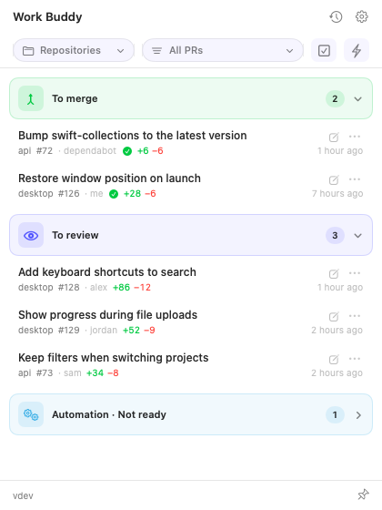

# Work Buddy

**Your GitHub pull request queue, one click away in the macOS menu bar.**

Work Buddy helps developers keep up with reviews across repositories: see what's
ready to merge, what needs your review, and which of your PRs need attention.
Approve, rebase, or merge from a compact panel, or jump into your editor or AI
agent to work on the code.

<picture>
  <source media="(prefers-color-scheme: dark)" srcset="docs/images/pull-request-queue-dark.png">
  
</picture>

macOS 14+ · Apple silicon & Intel · English & Spanish · MIT licensed

## What you can do

- **Find your next action.** Bring personal and team review requests together with
  PRs ready to merge, failing CI on your own PRs, and branches needing a rebase.
- **Act from the panel.** Approve, rebase, and merge individual PRs, or select
  several for batch approval or merging. Individual writes ask for confirmation
  by default; batches require an explicit start.
- **Keep Dependabot moving.** Separate automation from human reviews, optionally
  include repositories owned by your teams, and enable Autopilot to approve and
  merge eligible Dependabot PRs. Autopilot starts disabled.
- **Focus on your repositories.** Filter, favorite, or mute repositories, hide
  individual PRs, and keep private notes on items.
- **Continue in your own tools.** Associate a local clone with a repository to
  open a PR's branch in your editor or launch your configured AI agent CLI.
- **Stay up to date.** Refresh automatically every five minutes, receive
  notifications for newly actionable PRs, and check the local activity history.

An optional, experimental **Jira** integration adds assigned and recently created
tickets with configurable JQL queries. It is disabled by default.

## Install

Install with [Homebrew](https://brew.sh):

```bash
brew install --cask martintuk/tap/work-buddy
```

The download supports Apple silicon and Intel, is signed with Developer ID, and
is notarized by Apple. Homebrew also installs the GitHub CLI dependency.

Connect the GitHub CLI to your account, unless it is already authenticated:

```bash
gh auth login
```

Open **Work Buddy** from Applications, then click its orbit icon in the menu bar.
You can also open the panel from the Dock. Choose **English** or **Español** in
Settings → Language.

### First steps

1. Open **Settings → GitHub** to choose organizations and configure optional
   Dependabot team discovery.
2. Use **Repositories** to focus the queue and associate local folders if you
   want to open code in an editor or agent.
3. Double-click a PR to open it in the browser, or use its **⋯** menu for actions.
   Choose your editor, terminal, and agent in Settings.

The panel hides when it loses focus; use the pin icon to keep it open.
See the [user guide](docs/user-guide.md) for queue rules, batch actions, and
Autopilot behavior.

### Update

```bash
brew update
brew upgrade --cask work-buddy
```

### Manual installation

Download the ZIP from
[GitHub Releases](https://github.com/martintuk/work-buddy/releases/latest),
extract it, and move **Work Buddy.app** to Applications. Install the GitHub CLI
with `brew install gh` and sign in with `gh auth login`.

For Jira, install the Atlassian CLI (`acli`), sign in with
`acli jira auth login`, and enable **Settings → Jira (experimental)**.

## How it works

Work Buddy uses your authenticated GitHub CLI session to query PRs and organize
them by the action they need. It refreshes in the background and reflects
GitHub's review, CI, and mergeability status. Approvals and merges are checked
again against GitHub before they are sent.

Editor and agent actions use a local repository you associate with a PR's
repository. Work Buddy verifies the remote and commit before switching to the
PR branch; it does not reset branches or discard local work.

## Privacy and control

- **Credentials stay with the CLIs.** GitHub authentication is managed by `gh`;
  optional Jira authentication is managed by `acli`. Work Buddy does not ask you
  to paste tokens into the app.
- **Preferences and notes stay on this Mac.** Settings, repository associations,
  filters, and private notes are stored in local preferences. Activity history
  and diagnostic logs are stored under `~/Library/Application Support/work-buddy/`.
  Activity history can include PR titles, repository names, and action results.
- **Connected services receive their requests.** The app queries GitHub and sends
  actions you initiate, including those from enabled Autopilot. Jira requests
  run only when that integration is enabled. There is no Work Buddy backend or
  analytics service.
- **AI tools are optional.** Launching an agent starts your configured CLI in the
  local repository. Any data that tool sends is governed by its own configuration
  and service.

## Development

Install Xcode Command Line Tools (`xcode-select --install`), then clone the repo:

```bash
git clone https://github.com/martintuk/work-buddy.git
cd work-buddy
./scripts/run.sh
```

This builds, installs, and restarts the app at `~/Applications/Work Buddy.app`.
Full Xcode is not required for ordinary local builds. Use
`./scripts/run.sh release` for an optimized build, or set `WORK_BUDDY_APP_DIR`
to change the installation directory.

Run tests:

```bash
./scripts/test.sh
PYTHONDONTWRITEBYTECODE=1 python3 -m unittest discover -s Tests/scripts
```

See [Development](docs/development.md) for architecture, build options, and
interface text, or [Contributing](CONTRIBUTING.md) to get started with a change.

## More documentation

- [User guide](docs/user-guide.md): queues, actions, filters, agents, and activity.
- [Releasing](docs/releasing.md): signing, notarization, and distribution.
- [Diagnostics](docs/diagnostics.md): logs and performance measurements.
- [Measured assumptions](docs/assumptions.md): evidence and limits behind decisions.
- [Open decisions](docs/open-decisions.md): proposals and scope decisions.

## License

[MIT](LICENSE)
